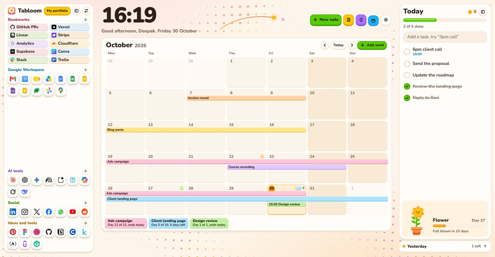
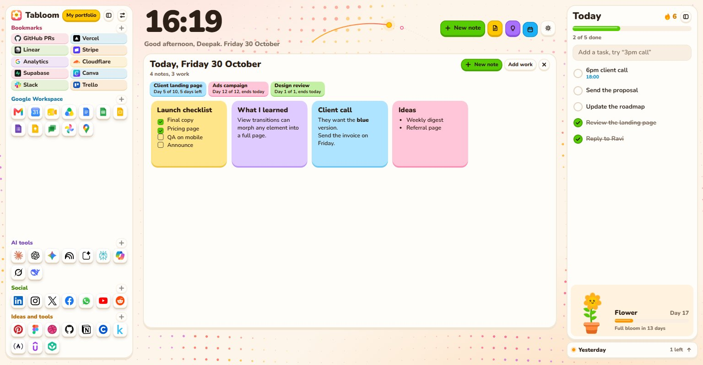
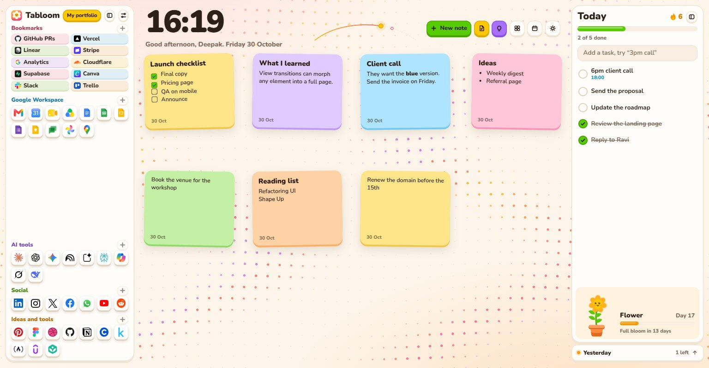
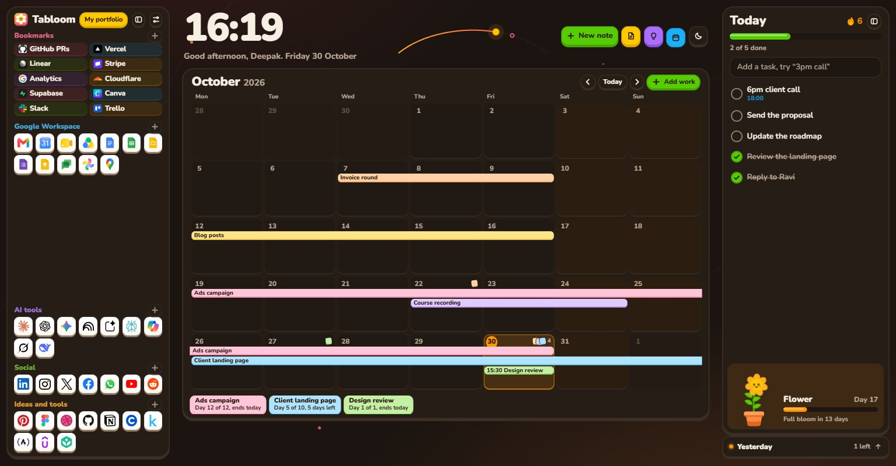
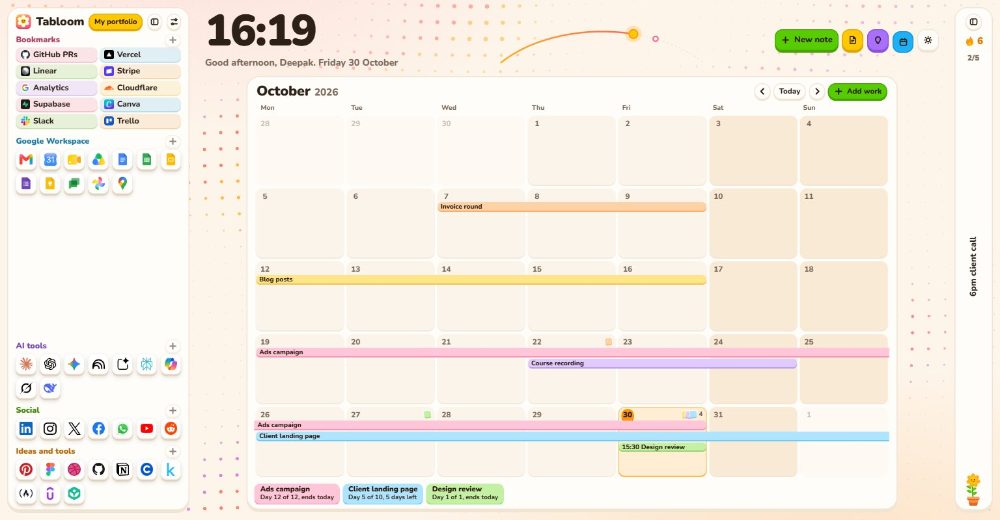
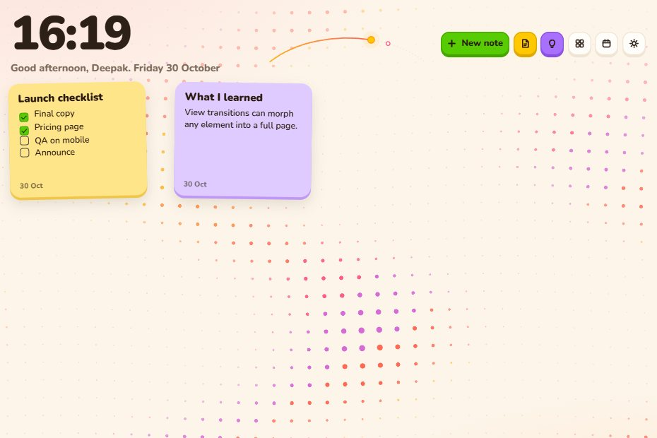
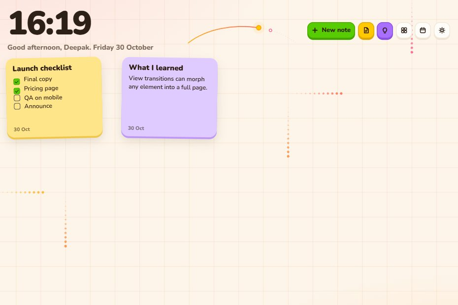
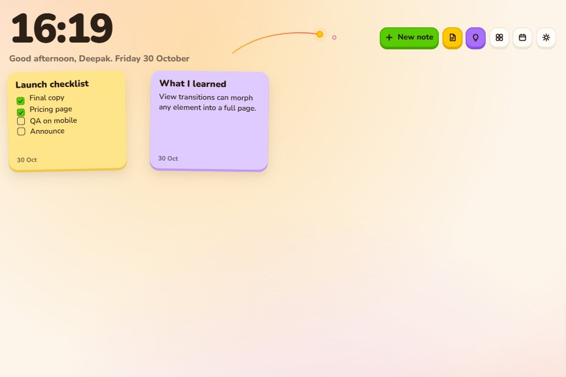
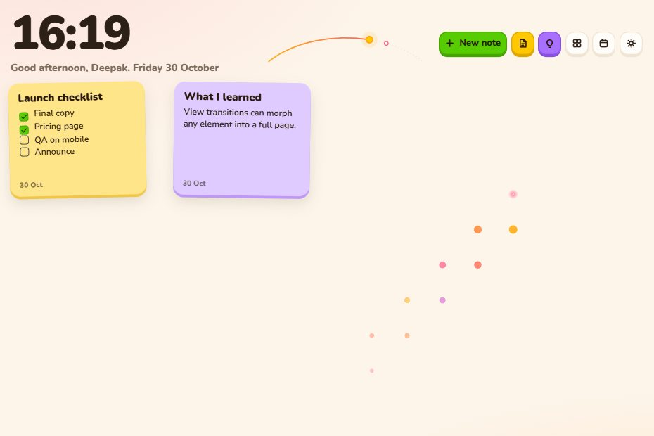

# Tabloom

Your new tab, in bloom. A colorful new tab for work. Bookmarks, Google apps and AI tools on the side. Sticky notes, today's tasks and a small plant that grows with you everywhere else.



**Website:** [tabloom.1619.in](https://tabloom.1619.in/)

## Download

**[Download the latest Tabloom](https://github.com/KumarDeepak16/tabloom/releases/latest/download/tabloom.zip)**, or see all [releases](https://github.com/KumarDeepak16/tabloom/releases).

## Install

Works in every Chromium browser, version 111 or newer.

1. Unzip `tabloom.zip` somewhere it can stay.
2. Open your browser's extensions page, from the table below.
3. Turn on **Developer mode**.
4. Click **Load unpacked** and pick the unzipped `tabloom` folder.
5. Open a new tab. When the browser asks, keep Tabloom's new tab page.

| Browser | Extensions page |
| --- | --- |
| Chrome | `chrome://extensions` |
| Edge | `edge://extensions` |
| Brave | `brave://extensions` |
| Opera | `opera://extensions` |
| Vivaldi | `vivaldi://extensions` |

Keep the folder where it is. The browser loads the extension from it on every start, and moving it makes the browser treat it as a new extension with empty data.

The first time, Tabloom asks your name and offers to restore a backup or add browser bookmarks.

### Firefox (beta)

Firefox is not a Chromium browser, so it has its own build, and that build has not been tested yet.

1. Download [tabloom-firefox.zip](https://github.com/KumarDeepak16/tabloom/releases/latest/download/tabloom-firefox.zip) and unzip it.
2. Open `about:debugging#/runtime/this-firefox`.
3. Click **Load Temporary Add-on** and pick `manifest.json`.

Firefox removes temporary add-ons when it closes. A permanent install needs the add-on to be signed by Mozilla.

### Update

Download the latest zip, replace the files in the same folder, then press the reload icon on Tabloom's card on the extensions page. Your notes and links stay. New default links are added once.

## Screens

| | |
| --- | --- |
|  |  |
| A date opens into everything on it | Calendar off, notes float |
|  |  |
| Dark, or Day and night by the clock | Collapse a side, tasks pass by one at a time |

## Backgrounds

| | | | |
| --- | --- | --- | --- |
|  |  |  |  |
| Dots | Grid lines | Aurora | Fireflies |
|  |  |  |  |
| Stars | Bubbles | Snake | Still |

## Use it

| To | Do this |
| --- | --- |
| Open a link | Click it. Ctrl+click opens a new tab |
| Add a link | The plus next to a section. Its icon is saved with the link |
| Edit or remove a link | Right-click it |
| Start a new doc, sheet, meeting and so on | Right-click the Google icon |
| Open your portfolio | **My portfolio** at the top of the sidebar. Set the link in Settings |
| Collapse the sidebar | The panel icon next to Settings, or press B. Icons stay one click away |
| Collapse the Today panel | The panel icon beside Today, or press T. Progress, streak and Bloom stay visible |
| Save the site you are on | Tabloom toolbar icon, or Alt+Shift+S |
| Save with the browser star | It lands in Bookmarks too. Turn off in Settings |
| Add many bookmarks at once | Settings > Add browser bookmarks, then **Select all** or search and tick, then Add. Search first to take one folder. The list scrolls past eight rows |
| Bring bookmarks from another browser | Import them into this browser first at `chrome://settings/importData`, then use Add browser bookmarks |
| New note | **New note**, or press N. An empty note is reused, never duplicated |
| Daily notes | **Today's note** and **What I learned** open the same note all day |
| Open a note full page | Click it. Esc or Done to close |
| Choose format | Markdown or Plain text, per note |
| Move a note | Drag it. **Tidy** lines them all up |
| Show or hide the calendar | **Calendar** button, press C, or Settings > Home layout. With the calendar, notes live inside their dates. Without it, notes float on the board |
| See a day | Click a date. It opens into that day's notes and work. Click a note to open it full page. Esc steps back |
| Add a note to a date | Open the date, then **New note** |
| Plan work | Drag across days on the calendar, or **Add work**. Pick a name, dates, optional time and color |
| See your schedule | Bars show which days each job runs. The strip below the month shows day counts and days left. Hover a bar for details |
| Edit or delete work | Click its bar or chip |
| Add a task | Type it in Today. A time like `3pm call` or `15:30 sync` shows under the clock |
| See earlier tasks | Click the card peeking out under Today. Tick them off, or move one to today with the arrow |
| Change the background | Settings > Background animation: Dots, Grid lines, Aurora, Fireflies, Stars, Bubbles, Snake or Still |
| Pop bubbles | In Bubbles mode, touch one with the cursor. Your count shows under the clock |
| Save selected text from any page | Select it, right-click, **Add to Tabloom**, then Notes, What I learned or To-do. Notes and What I learned each have a "with page link" choice. A green tick on the toolbar icon confirms it |
| Save a link or page to any section | Right-click it, **Save link to Tabloom**. Pick a section, or **New section** to create one like Certificates. The toolbar icon offers the same. A new section disappears with its last link |
| Switch theme | The theme key in the header cycles Light, Dark, then Day and night, which is light from 7 AM to 7 PM and dark otherwise. Settings also offers System |
| See your meetings | Paste your Google Calendar secret iCal address in Settings. The next two appear under your to-dos with a Join button, and as dots on the day path |
| See recent Google docs | Settings > Recent Google docs > Show, then allow history access |
| Read the header | The sun walks the day from 6 AM to 10 PM. Dots on the path are timed tasks and meetings; hover one. Hover the icon keys for their names |
| Use your own image | Settings > Background image: upload or paste a link, then set Blur and Dim |
| Switch 12 or 24 hour clock | Settings > Clock |

Tasks left at midnight move to the card under Today and wait there. Finished ones stay visible for a week. The flame counts days in a row with a finished task.

**Bloom**, the plant in the Today panel, grows one step each day you open Tabloom: seed, sprout, seedling, bud, flower, full bloom at day 30. Missed days never set it back. Click it to say hello.

Change the save shortcut at `chrome://extensions/shortcuts`.

## Your data

Everything stays in this browser's extension storage, and there is no account or sync. Two exceptions: if you add your calendar address, Tabloom reads that feed from Google every 15 minutes, and when a link's icon is not already in your browser, Tabloom asks Google's favicon service for it once, which shares that site's domain with Google. Local addresses are never sent.

**Removing the extension deletes your notes**, so use Settings > Export file first. Import file restores notes, tasks, calendar, links and settings together, also on another computer. An uploaded background image is not in the file, so upload it again there.

## Project layout

```
manifest.json   Extension config
newtab.html     The page
popup.html      Save-this-page popup
css/            tokens.css, ui.css (button and parts), app.css, popup.css
src/            main, store, links, notes, today, bloom, dots, photo, favicon, markdown, lib, sw
assets/         icons, font, logo
tests/          Unit tests for parsing and URL safety
DESIGN.md       Design system
```

No build step and no runtime dependencies. Edit a file, then press reload on the extensions page.

Run tests with `node --test tests/lib.test.mjs`.

## Permissions

| Permission | Why |
| --- | --- |
| `storage`, `unlimitedStorage` | Keep notes, tasks and links |
| `bookmarks` | Import the bar and catch starred pages |
| `favicon` | Show real site icons for links you add |
| Google favicon addresses | Fetch an icon the browser does not have yet |
| `contextMenus` | Add to Tabloom on selected text |
| Google Calendar address | Read your meetings, only if you paste your feed |
| `history`, optional | Recent docs, asked only when you turn it on |
| `activeTab` | Read the current page's title and address when you click save |

## Contributing

See [CONTRIBUTING.md](CONTRIBUTING.md).

## License

[MIT](LICENSE). Made by Deepak Kumar, [1619.in](https://1619.in).

## Credits

Nunito font, SIL Open Font License. Product logos belong to their owners and are used here to link to those products. This is a personal tool; check each brand's rules before publishing it on a store.
